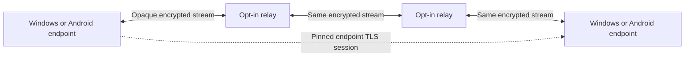

# Bluetooth relay development: Windows PCs and Android phones

Date: 1 November 2026. The user confirmed the present app works and requested that it be preserved. The new target is encrypted, offline document communication over participating relays, ultimately measured over an 800 m to 1 km route. This document is a development and acceptance contract, not a range or production certification.

## Preserved baseline

The running package remains `windows-x64-1793488092292`, frontend `6b75a0e6341b586e`, native `47b9247bbfa3239d`. A separate working checkpoint contains the full non-ignored source snapshot, runnable Windows ZIP, launchers, verification scripts, Git provenance, restore instructions and SHA-256 manifest. Browser documents remain in IndexedDB; the checkpoint is not a workspace document export. No document schema, launcher, existing package or live radio behavior is changed by phase one.

## Feasibility and scope

1. A relay must run compatible software with its owner's explicit consent and required OS permissions. A discoverable device, headset, switched-off phone or arbitrary nearby Bluetooth device is not a general packet forwarder. A background relay can work only while its native service/process is permitted to run. Android force-stop, process death and background restrictions are real failure conditions.
2. Every adjacent pair must have a working radio link. Software cannot fill a gap with no cooperating node. A chain reaching one distant endpoint does not prove coverage of an entire 800 m radius. For illustration only, 800 m at a *measured and reliable* 40 m spacing would require at least 20 links and 19 intermediate nodes on a straight route, before margin and redundancy. This is arithmetic, not a laptop-range estimate or deployment recommendation.
3. The current transport is Windows Classic Bluetooth RFCOMM. It is not the Bluetooth SIG Bluetooth Mesh protocol. An application overlay above RFCOMM is a candidate to test with Windows and Android; selecting it for production requires simultaneous incoming/outgoing radio tests and capacity measurements. BLE/Coded PHY or Bluetooth Mesh would be separate transport work, not a switch that increases the current RFCOMM range.
4. Desired confidentiality means relays cannot obtain document content, titles, document IDs, authentication invitations or end-to-end traffic keys. Relays still see their adjacent radio peers, connection timings, traffic sizes and outages. Padding can reduce some traffic analysis but cannot justify a promise of zero metadata leakage.
5. Endpoint compromise, a stolen invitation, a recipient sharing plaintext, radio jamming and malicious relays discarding data remain outside an unconditional confidentiality/availability guarantee. Encryption alone cannot force delivery or secure a compromised endpoint. No claim of "security proof" or exhaustive testing is allowed.

## Architecture to validate

Maintain an end-to-end authenticated encrypted session between the actual document endpoints, inside the forwarding path. Do not decrypt/re-encrypt document messages at each relay. The existing Go endpoint uses TLS 1.3, a pinned ephemeral host certificate and a random invitation secret checked before offering the document. The lab uses that implementation rather than inventing a cipher or key exchange. This is a feasibility choice; Android TLS/provider interoperability and independent security review remain open.

The document invitation is transferred directly to the intended endpoint through a trusted out-of-band method. It is never a relay route token. Production relays receive separate bounded circuit/neighbor authorization, random short-lived routing handles and opaque bytes. Route setup must not contain plaintext titles, document IDs, invitation secrets or endpoint private keys. Hop admission and optional link encryption are additional controls, not substitutes for end-to-end encryption.

Start with a manually chosen fixed path. The overlay must supply a reliable ordered stream or tear down the circuit. A changed path starts fresh endpoint authentication; missing document edits are recovered from the endpoint's durable Yjs journal. Do not splice reordered records, replay ciphertext, or claim delivery after a relay accepts bytes. Only an authenticated destination journal commit may acknowledge document delivery. Streaming relays do not persist payloads. Offline store-and-forward messaging needs a separately reviewed encrypted envelope and replay design.

## Phases and exit gates

| Phase | Work | Exit evidence | Current status |
| --- | --- | --- | --- |
| 0 | Freeze the known working app and verify a restore checkpoint | Source/ZIP hashes, runnable artifact, existing test reports, restore directions | Saved; browser document backup remains a user export |
| 1 | Threat model, bounded in-memory forwarding lab and attack scenarios using existing endpoint authentication | Actual tests of multiple hops, exact two-way payloads, captures in both directions, wrong identities/secrets, stream mutation, duplication/replay, broken path and cancellation; explicit untested list | Lab implemented; results in the generated phase-one report |
| 2 | Separate experimental fixed-path Windows connector | Separate port/build tag and relay service UUID; authenticated admission before original endpoint TLS; physical multi-link trial | Experimental connector implemented; hardware gate open; stable app unchanged |
| 3 | Android native relay application and cross-platform endpoint interoperability | Buildable/signed development APK; permission flows; native RFCOMM streams; foreground/background lifecycle; Windows–Android–Windows hardware evidence | Debug APK builds with zero lint issues; physical validation and Android document endpoints still pending |
| 4 | Multi-hop route management and recovery | Authenticated discovery; bounded hops/circuits/queues; loop prevention; duplicate suppression; backoff; route expiry/revocation; malicious-node tests; destination-only commit acknowledgements; failure recovery without lost edits | Not implemented |
| 5 | Field measurements and production hardening | Measured 800 m route, optional 1 km stretch, obstacle/interference/mobility trials, soak/load/battery results, signed releases/rollback, supported hardware matrix, dependency review and independent security assessment | Not measured or certified |

Do not silently activate experimental relays, change the stable app's protocol, replace the working ZIP or advertise distance before these gates pass. A later experimental artifact must use a separate package directory and explicit mode; endpoint document storage must keep a tested migration/rollback path. Releasing an experiment is not the production release gate.

## Scenario coverage

The machine-readable [scenario register](BLUETOOTH-RELAY-SCENARIOS.json) records normal, boundary, adversarial, resource, lifecycle and field scenarios. A scenario marked `lab-covered` identifies the particular test and the limited property exercised. It does not mark the corresponding hardware or production condition passed. All other scenarios stay `pending`. The register is intentionally extensible: it is not a claim that every conceivable scenario has been enumerated.

For every physical run, record endpoint/relay hardware, OS and driver versions, app and native hashes, route graph, actual relay count, distances and conditions, start/end times, byte counters, exact-content/convergence checks, destination journal acknowledgements, failures, latency percentiles, throughput, memory and battery consumption. Do not put document content, invitations, private keys, stable personal identifiers or raw packet captures in shared reports. Test captures in phase one are synthetic, memory-only and discarded when the process exits.

## Running phase one

From the workspace parent, run `node Verify-Relay-Phase1.mjs`. It runs Go tests against injected memory/loopback transports, writes a JSON report and verifies hashes of the stable source, ZIP and extracted app. It does not start a relay service or touch the running app. A Windows amd64 race-detector pass needs a compatible 64-bit C toolchain; an available 32-bit MinGW compiler does not satisfy that gate. Missing tools are reported, never converted to a pass.

## Sources checked for this design

- [Bluetooth SIG: range depends on PHY, power, antennas and path loss](https://www.bluetooth.com/learn-about-bluetooth/key-attributes/range/).
- [Bluetooth SIG: Mesh networking and relay architecture](https://www.bluetooth.com/learn-about-bluetooth/feature-enhancements/mesh/). This describes a separate Bluetooth Mesh protocol, not automatic RFCOMM forwarding.
- [Microsoft: Classic Bluetooth Windows Sockets](https://learn.microsoft.com/en-us/windows/win32/bluetooth/bluetooth-programming-with-windows-sockets).
- [Android: native Bluetooth connections](https://developer.android.com/develop/connectivity/bluetooth/connect-bluetooth-devices) and [runtime permissions](https://developer.android.com/develop/connectivity/bluetooth/bt-permissions).
- [Android: Bluetooth background work](https://developer.android.com/develop/connectivity/bluetooth/ble/background). This page discusses BLE specifically; general process/service limits require validation for the proposed Classic relay too.
- [IETF TLS 1.3 specification, RFC 9846](https://www.rfc-editor.org/info/rfc9846/): authenticated encryption protects content; traffic lengths are not hidden. It supersedes RFC 8446. The current app's Go toolchain and TLS implementation still need a release-specific vulnerability/interoperability review.
- [Go race detector](https://go.dev/doc/articles/race_detector): running tests without `-race` is not a race-detector pass.

## Phase-one results

The first completed protocol run passed 23 distinct relay test scenarios ten times each (230 executions), along with the existing nearby and asset-server checks. `go vet` passed. The baseline verifier checked 726 source/workspace files and 449 installed package files against the saved checkpoint before and after the lab run. The running app still reported its original frontend/native versions.

The race-detector run could not compile because the installed MinGW compiler lacks 64-bit mode. That gate remains open. The scenario register contains 11 lab coverage rows and 56 pending native, Android, routing, durability, range, performance and release scenarios. At the end of the original phase-one lab, no Android APK had been built. The subsequent prototype results are recorded below; physical relay links, 800 m/1 km measurements and independent security review remain unverified. See the workspace parent's `Diwan-relay-phase1-verification.json` for the lab's exact results and rerun `Verify-Relay-Phase1.mjs` to regenerate them.

## Subsequent Android prototype and archive organization

The user supplied two Windows laptops and two Android phones (Samsung A36 and OnePlus Nord; exact phone variants and Android versions await device measurement), then authorized Android SDK installation and its license. The separate Android relay APK now compiles and passes Android lint with no issues. JVM checks cover admission validation and bounded concurrent byte forwarding. Additional tagged Go loopback tests cover DRL1 admission followed by bidirectional document TLS, rejection of wrong relay tokens, and rejection of wrong document pins/secrets. These are software results; the original phase-one report above remains historical in scope. The Android app relays only; Android document editing is not implemented.

See [the experiment guide](../experiments/android-relay/README.md) for one-phone and two-phone physical test procedures. The experimental receiver uses port 8768 and its own browser store; the known working app stays on port 8765. The setup and test reports must not be read as support certification for either phone or as an 800 m range result.

At the user's request, source backups/checkpoint folders, old packages, release ZIPs and downloaded tool archives moved to the sibling `W-Archives` directory. Three exact duplicate ZIPs were removed after hash verification; aliases are retained in its index. The current app and checkpoint contents are unchanged. Backup tools and legacy test fixtures resolve the new archive locations. Rebuilding the experimental Windows connector reuses one canonical output directory instead of making timestamped copies.
