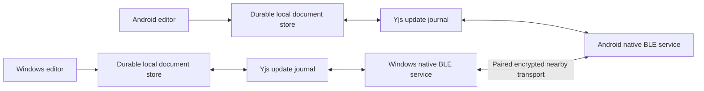

# Offline documents and nearby collaboration: Windows + Android

Status, 1 November 2026: a Windows-to-Windows Bluetooth preview is implemented, pending physical two-laptop data-exchange validation. This is a staged engineering plan, not a production-readiness claim. See [the Windows Bluetooth guide](WINDOWS-BLUETOOTH.md) for setup, current limits and the physical acceptance checklist.

Long-term target platforms: **Windows laptops and Android phones**. The current package runs from bundled assets and stores documents locally. Windows now has native classic Bluetooth RFCOMM with OS authentication/encryption, TLS 1.3 certificate-pinned invitations, and opt-in durable Yjs journals with reconnect resynchronization and acknowledgement after the peer's journal commit. Android remains unimplemented. Current evidence and its limits are recorded in [OFFLINE-NEARBY-PROGRESS.md](OFFLINE-NEARBY-PROGRESS.md).

The [user safety audit](OFFLINE-USER-SAFETY-AUDIT.md) documents the subsequent beginner/advanced-user fixes and explicitly lists unverified scenarios and release gates.

The original cross-platform roadmap below separates persistence from radio availability. Its BLE services describe a historical proposal, not the implemented Windows transport:

The current Windows preview has a local snapshot store, persistent Yjs replicas/journals and a native RFCOMM service; its browser talks only to its own loopback helper at `127.0.0.1:8765/_nearby/`. The Android and BLE branches above remain future roadmap work. Earlier statements that all journals/native Bluetooth were pending describe the original milestone. A real local-radio probe passed radio, paired-device, RFCOMM listener and SDP register/remove checks, but no actual two-laptop exchange has been verified.

## Product contract

- An installed copy starts with the internet disconnected. Opening, creating, editing, saving, reopening, and exporting a document require no account server, DNS, cloud tunnel, STUN/TURN service, or internet connection.
- A device owns its durable local document state. A remote peer is never the only copy. “Saved on this device” means the local storage transaction completed, not merely that a network request was queued.
- Nearby devices discover and pair with explicit user consent. Bluetooth is an actual radio transport, not a simulated list of devices or a renamed cloud WebRTC connection.
- Concurrent rich-text edits use the existing Yjs document model. Snapshot overwrites must not replace missing concurrent operations. Reconnection exchanges state vectors and missing updates, idempotently.
- Unsupported hardware, denied permissions, full storage, interrupted writes, and disconnected peers are visible states. No false “Connected”, “Synced”, or “Saved” indicators.
- The offline application has internet access disabled by default. Cloud sync is a separate, explicit product mode, not a fallback used when nearby communication fails.

## First launch and distribution

A new browser cannot fetch an unknown website URL with no connection and no installed assets. Ship the application assets in a Windows offline package and an Android APK; both can be copied over USB or an existing nearby-sharing mechanism. A PWA can also launch offline after its complete installation cache has finished. Vercel remains a distribution/optional online channel, not a dependency of the offline product.

Use the current Go/React editor core. Windows can serve the bundled shell over loopback; Android packages the same shell in a local WebView asset origin. No third-party fonts, scripts, images, analytics, or online login may be fetched by the offline shell. Service-worker caches contain application assets only; private documents live in the document store.

## Original implementation sequence and gates

The following stages preserve the broader Windows/Android design and acceptance goals. Windows journal and native-transport implementation has since advanced as described above; BLE/WinRT/Android proposals below must not be read as the current RFCOMM implementation or as passed hardware gates. Automated TCP/TestWire protocol simulations are not physical Bluetooth evidence.

### 1. Local document workspace — first implementation

Build a separate offline artifact to protect the existing hosted deployment. Route supported document operations to a transactional IndexedDB store before endpoint selection or fetch. Include document IDs, revisions, folders, bounded version history, and device metadata. Reject stale writes instead of silently replacing another tab's work. Keep a last-resort draft until its exact save is acknowledged. Guard editor hydration and clean up pending saves on unmount so a blank loading editor cannot overwrite a draft.

Generate a complete, versioned application-asset cache. Disable endpoint priming and internet collaboration in the offline artifact. Show local-storage state explicitly and provide a workspace export.

Gate: real Chrome tests with all API requests forbidden, offline creation/edit/reload, complete browser restart with persistent profile, storage errors, concurrent stale writes, version restoration, draft preservation, and zero external requests. Test an offline installer on a disconnected clean machine before calling first-launch support complete.

### 2. Durable CRDT journal and local replica identity

Persist validated Yjs updates and local checkpoints, transactionally, with a durable per-device identity. Replay the journal before making an editor editable. Coalesce incremental writes without skipping durability acknowledgements. Keep compaction crash-safe; retain a previous usable checkpoint until the new one commits. Add explicit backup/import with schema migration and corruption detection.

Gate: crash/restart after every persistence boundary; duplicate, reordered and delayed updates; simultaneous edits to paragraphs, tables, marks, undo, comments and images; two isolated replicas reconnecting after both restart; no lost edits and equivalent converged states. Concurrent snapshot saves alone do not pass this gate.

### 3. Native nearby connection on Windows and Android

Web Bluetooth is a BLE central/client API, not a general browser peripheral/GATT-server implementation. Windows requires a native companion using WinRT Bluetooth APIs; Android requires native GATT client/server and advertiser/scanner APIs. Check radio availability, peripheral-role capability, permissions and advertising support at runtime. Windows-to-Windows, Windows-to-Android and Android-to-Android are separate hardware gates.

Keep platform code outside the editor. Expose a narrow, authenticated bridge bound to the application origin, with strict message validation, request IDs, cancellation and byte limits. Windows helper IPC must not become an unauthenticated localhost remote-control endpoint. Use Android's app asset loader and a scoped WebView bridge; do not expose an unrestricted JavaScript interface to arbitrary web pages.

Discovery advertises only a protocol/service identifier and an opaque temporary device ID, never document titles or content. Pair using a QR/short authentication string and explicit acceptance on both devices. Store long-lived private keys in platform-protected storage (Windows DPAPI / Android Keystore). Reuse reviewed room encryption and validate all incoming document updates before applying them.

Transport: negotiate protocol version and maximum payload; fragment bounded encrypted messages to the negotiated ATT payload; serialize GATT writes; implement acknowledgements, retransmission, duplicate suppression, backpressure, reconnect/resume and cancellation. Expire incomplete transfers and cap buffered bytes. Presence/cursor traffic is expendable; document operations are not. Large attachments use a separate resumable, checksummed transfer. BLE discovery may later negotiate a direct local Wi-Fi data path for throughput, with no internet dependency and a clear indication of the actual transport.

Gate: real radio tests on the selected Windows adapter and at least two Android phones. No browser emulation or unit test is evidence that Bluetooth works on hardware.

### 4. Release hardening

Test installer upgrades, data migration/rollback, disk exhaustion, permission changes, Android process death/background limits, Bluetooth toggling, sleep/wake, range loss, malformed peers, repeated reconnects and large-document memory use. Perform threat-model review and dependency/license checks. Publish a supported-device matrix and measured limitations.

Performance targets to measure, not claims already achieved: local typing p95 under one 16 ms frame on the agreed reference machines; ordinary local save acknowledgements p95 under 100 ms; nearby small-edit convergence p95 under 300 ms on an established healthy link. Measure pure Bluetooth separately from local Wi-Fi. A congested or disconnected radio cannot provide a zero-lag guarantee.

Production release requires measured results, physical-device evidence, recovery tests and a rollback path. “No bugs” cannot be certified by a single successful demo.

## This implementation's boundary

The implemented scope is a Windows-only preview for one explicitly shared Docs document and one peer, with a 512 KiB source-JSON limit, 1 MiB replica/update limit and 30-minute invitation/session. Ordinary local documents keep their existing save flow until sharing is enabled. Native Windows RFCOMM, invitation authentication and durable Yjs replay/resynchronization are implemented; Android, physical two-laptop validation, the supported-device matrix and production hardening remain gates. No peer-connection success or production readiness is claimed.

## Primary references

- Browser BLE central role and user-gesture requirements: https://developer.chrome.com/docs/capabilities/bluetooth
- Windows GATT server: https://learn.microsoft.com/en-us/windows/apps/develop/devices-sensors/gatt-server
- Android BLE: https://developer.android.com/develop/connectivity/bluetooth/ble/ble-overview
- Android local WebView assets: https://developer.android.com/develop/ui/views/layout/webapps/load-local-content
- Bluetooth ATT/GATT fragmentation constraints: https://www.bluetooth.com/wp-content/uploads/Files/Specification/HTML/Core-62/out/en/host/generic-attribute-profile--gatt-.html
