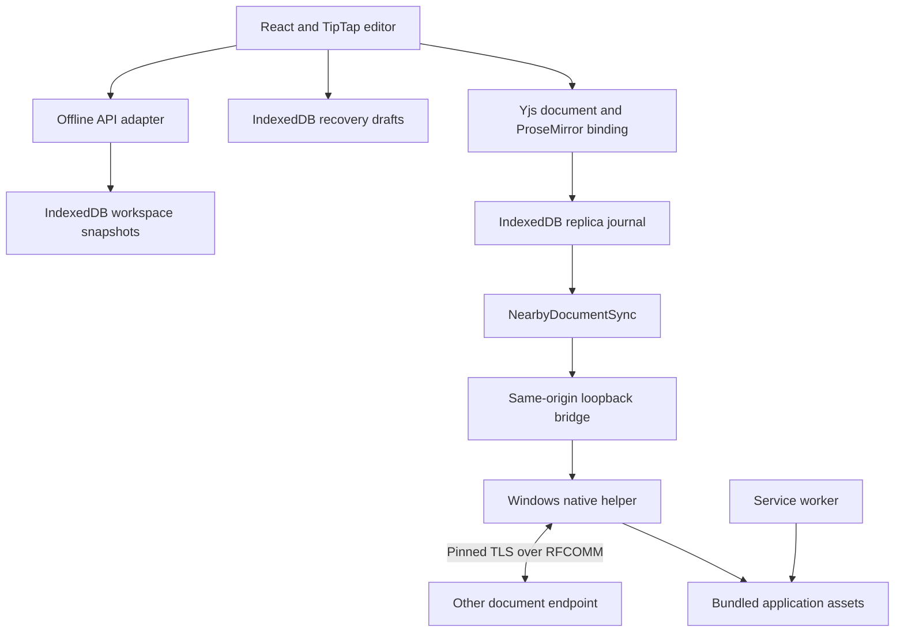
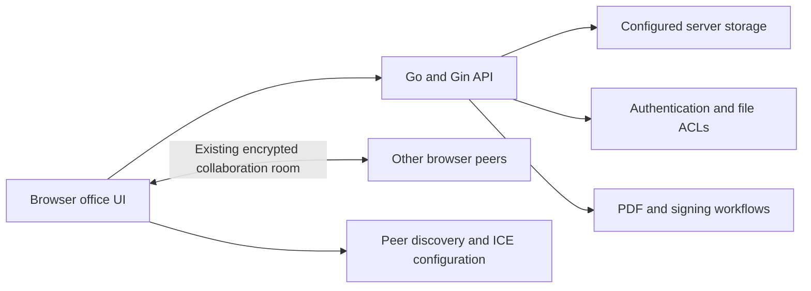
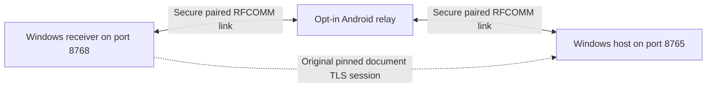

# BIOS2026 / LocalFirst: Complete Technical Handbook

**Edition:** 1 November 2026. **Source baseline:** [`d7e9135`](https://github.com/Vasu-Gupta105/BIOS2026/commit/d7e9135c65860530032173fecfb81eff696af6c6). **Audience:** presenters, judges, maintainers and technical reviewers.

This handbook describes the source and available verification evidence. It separates the inherited office platform, the working Windows offline build, the implemented experimental relay software and the longer-range roadmap. A feature present in source is not automatically a feature validated on every device.

## 1. Project in one paragraph

BIOS2026 develops a local-first document workspace on top of the original open-source [Diwan office suite](https://github.com/vul-os/diwan). The current Windows package opens a browser interface from a local executable, stores documents on that device, and supports an explicitly shared Docs document over native Bluetooth. Local snapshots, recovery drafts and durable Yjs journals address different failure cases. A separate experimental Android app can forward a fixed route between selected Bluetooth neighbors while the document endpoints retain their original authenticated TLS session. Automatic mesh routing and an 800 m–1 km operating range are future goals, not completed measurements.

The useful engineering question is: **Can people keep creating and recovering their documents when internet service disappears, then exchange edits over an explicitly authorized local transport without giving forwarding devices the document keys?**

## 2. What belongs to this project, and what came from upstream

The repository is derived from [vul-os/diwan](https://github.com/vul-os/diwan), under the existing MIT OR Apache-2.0 license. The local inherited baseline was commit `8cdb6f5`. The contribution comparison to `d7e9135` shows 102 changed files, 7,717 insertions and 238 deletions, including the README merge. Those numbers describe the diff; they do not measure intellectual ownership or product quality.

| Layer | Inherited foundation | Work added or changed in this version |
| --- | --- | --- |
| Office UI | React application; Docs, Sheets, Slides, Whiteboards, PDF/signing surfaces | Offline status, recovery behavior, lazy loading, accessible controls and nearby-sharing UI |
| Editing | TipTap/ProseMirror, Yjs integration and other existing editor engines | Opt-in durable local replica lifecycle and native-nearby synchronization wiring |
| Hosted backend | Go/Gin, file APIs, storage adapters, authentication, ACLs, signing, rendezvous | Cloud/offline build and deployment support, plus a separate offline executable |
| Persistence | Hosted snapshots, revision checks, optional update logs; existing browser draft support | Transactional offline workspace, stronger draft acknowledgement, backup/restore and local Yjs journal |
| Nearby transport | Existing online WebRTC collaboration is a separate inherited path | Native Windows Classic Bluetooth RFCOMM, local bridge, pinned TLS invitation and Bluetooth setup guidance |
| Relay experiment | Standard Android and Go libraries | Fixed-route Android forwarder, distinct DRL1 admission, experimental receiver and bounded forwarding tests |

A defensible attribution statement is: “We extended an existing open-source office platform to build and test this offline persistence and Bluetooth workflow.” Avoid “we wrote the whole office suite from scratch” or “we invented CRDTs, TLS or Bluetooth mesh.”

## 3. Four modes that must not be mixed together

| Mode | Document persistence | Inter-device transport | Current interpretation |
| --- | --- | --- | --- |
| Hosted/self-hosted platform | Backend storage through HTTP APIs; optional server update log | Existing WebRTC peer collaboration with discovery infrastructure | Inherited platform capabilities; deployment-specific configuration matters |
| Windows offline workspace | Browser IndexedDB on `http://127.0.0.1:8765` | No transport needed for local editing; native Bluetooth for opted-in Docs | Current working package; Docs is the focus of the stronger verification |
| Android relay experiment | Documents remain on Windows endpoints; relay does not store document payloads | Fixed chain of paired Classic RFCOMM links containing the original endpoint TLS stream | APK and connector pass software checks; physical multi-link behavior remains to be validated |
| Future extended network | Intended durable endpoint replicas | Planned authenticated route management across participating relays | Automatic discovery/rerouting and 800 m–1 km range are unimplemented or unmeasured |

`OFFLINE_ONLY` is a **build-time** flag: `VITE_OFFLINE_ONLY === 'true'`. It is not a login bypass that an ordinary hosted client enables at runtime. In that build, the API abstraction routes supported operations into a local adapter before selecting any cloud endpoint. Unsupported operations fail explicitly with status-like errors, usually 501, instead of silently making a network request.

## 4. Technology stack and why each component exists

### 4.1 Frontend and office engines

The table distinguishes the installed lockfile version from dependency ranges. A declaration such as `^2.11.7` is a permitted range, not proof that exactly version 2.11.7 is installed.

| Technology | Lockfile version | Responsibility |
| --- | --- | --- |
| React / React DOM | 18.3.1 | Component rendering, state-driven interface and lifecycle |
| React Router DOM | 7.18.1 | Routes such as `/docs/:id` and editor navigation |
| TypeScript | 6.0.3 | Compile-time checking of models, bridge messages and UI code |
| Vite | 8.1.4 | Module bundling, code splitting and production assets |
| Zustand | 5.0.12 | File list and native-nearby status stores |
| TipTap / bundled ProseMirror | 2.27.2 | Structured rich-text editing, schema and transactions |
| Yjs | 13.6.31 | Mergeable shared document state and binary update encoding |
| y-prosemirror | 1.3.7 | Binding between ProseMirror structure and the Yjs fragment |
| FortuneSheet React | 1.0.4 | Existing spreadsheet interface |
| Excalidraw | 0.18.1 | Existing whiteboard interface |
| Tailwind CSS | Dependency range `^3.4.17` | Utility styling and responsive layouts |
| DOMPurify | Dependency range `^3.4.5` | Existing HTML sanitization boundaries |

Import/export libraries include SheetJS `xlsx` 0.20.3, Mammoth 1.12.0, `docx` 9.6.1, `pdf-lib` 1.17.1, PDF.js 4.10.38 and PptxGenJS 3.12.0. Their presence enables particular format workflows; it does not prove perfect Microsoft Office round-trip fidelity for every document.

### 4.2 Native, backend and storage stack

| Technology | Version or choice | Use |
| --- | --- | --- |
| Go | `go 1.25.0`; requested toolchain `go1.25.12` | Native helper, backend and typed concurrency |
| Gin | 1.9.1 | Existing hosted HTTP server; the small offline server uses Go `net/http` directly |
| Go `crypto/tls`, `crypto/x509`, `crypto/rand` | Standard library from the selected Go toolchain | Endpoint TLS, ephemeral certificate and unpredictable secrets |
| Windows Winsock / AF_BTH / RFCOMM | Native Windows APIs | Actual Classic Bluetooth sockets, SDP registration and paired-device access |
| IndexedDB | Browser API | Offline snapshots, draft records and replica journals |
| PostgreSQL driver `pgx/v5` | 5.10.0 | Existing hosted PostgreSQL storage option |
| `modernc.org/sqlite` | 1.50.1 | Existing hosted auxiliary stores; not the offline browser document database |
| Prometheus client / OpenTelemetry | 1.23.2 / 1.43.0 | Existing hosted observability support |
| Android application | Java 17, minimum API 26, target/compile API 36 | Experimental native relay service and permission-aware UI |
| Android Gradle Plugin | 8.13.0 | Android compilation, packaging, lint and debug signing |
| Gradle | 8.13 | Build orchestration for the Android experiment |

An important distinction: Node.js and the JDK are development tools. Users of the packaged Windows offline executable do not need Node.js or Go installed. Building the Android APK needs a local SDK/JDK/Gradle environment; running the installed APK does not require those development tools on the phone.

### 4.3 Test stack

Vitest 4.1.7 tests browser-side logic. Playwright Test 1.61.1 drives real Chrome scenarios. Testing Library tests React behavior, fake-indexeddb supplies a controlled IndexedDB implementation, and MSW supports request-level integration tests. Go tests inject memory or loopback transports to separate protocol behavior from radio hardware. JVM tests exercise the Android forwarding core without pretending to exercise the Android framework.

## 5. System architecture

### 5.1 Windows offline architecture



The browser owns editing and local document persistence. The Go helper owns platform radio access, socket lifetimes and native authentication. The service worker owns application assets, not private document records. This separation permits local editing to continue even when the radio is unavailable.

`127.0.0.1` means “this computer.” Each laptop opens its own local server. The two local HTTP servers do not exchange document edits over a Wi-Fi LAN; native Bluetooth sockets carry the inter-laptop path in the offline preview.

### 5.2 Hosted architecture



The hosted system can persist whole-document snapshots and metadata on the server. Its CRDT collaboration path is distinct from ordinary REST storage. End-to-end encryption of collaborative transport does **not** by itself establish that every server snapshot, export or database record is encrypted from the server administrator. Documentation must identify which data path a privacy claim refers to.

The main storage factory selects local or PostgreSQL storage, with `DATABASE_URL` or `VULOS_DATABASE_URL` able to select PostgreSQL. A separate S3-compatible configuration/client layer supports Tigris or MinIO-style object storage concerns; it must not be described as the active offline database. Authentication, ACLs, comments, suggestions, signing and observability belong to the hosted platform unless their offline paths are specifically implemented and verified.

### 5.3 Experimental relay architecture



The phone forwards an opaque reliable byte stream after separate relay admission. The original document TLS session terminates on the two document endpoints. The phone is not a document editor, TLS document endpoint or automatic internet gateway.

## 6. Local data models and storage boundaries

The offline workspace database is `diwan-local-workspace`, schema version 1. It has four stores: `files`, `folders`, `versions` and `metadata`. File IDs and folder IDs are explicit keys. The version store also indexes `file_id` so history can be retrieved without interpreting the document body.

| Model | Important fields | Meaning |
| --- | --- | --- |
| Local file | `id`, `name`, `type`, `content`, `rev`, `owner`, `parent_id`, `starred`, `trashed`, timestamps | Saved document snapshot and workspace state |
| Nearby flags | `nearby_enabled`, `nearby_initial` | Opt-in replica mode and a newly accepted document awaiting its initial replica |
| Local folder | `id`, `name`, `parent_id`, `trashed`, `created_at` | Workspace hierarchy |
| Local version | `id`, `file_id`, `name`, `content`, `rev`, `created_at`, `label` | A bounded prior snapshot |
| Device metadata | `key`, `id`, `created_at` | Device-local identity metadata, not an invitation secret |

The draft database is separately named `diwan-drafts`, with a `drafts` store. A draft contains the file ID, title, content, timestamp and an acknowledgement token. The replica database is `diwan-replicas`, with a `checkpoints` store keyed by file ID and an auto-incrementing `updates` store indexed by file ID.

These are separate persistence responsibilities:

1. **Snapshot:** the saved JSON representation the workspace can list and export.
2. **Draft:** a recovery copy around an interrupted ordinary save.
3. **Journal:** binary Yjs operations needed to recover and merge a shared replica.
4. **Application cache:** JavaScript, CSS, fonts and other assets needed to open the app.

Clearing the service-worker cache is not the same as clearing IndexedDB. Clearing all browser site data can remove both. Changing browser profile, host spelling or port changes the storage origin, which can make existing documents appear absent even if the old origin still has them. Port 8768 deliberately has a different experimental workspace from port 8765.

## 7. Document creation and ordinary save logic

Creation validates a supported file type, a non-empty trimmed name and the content-size bound. It assigns a random UUID, initial revision 1 and timestamps, then writes the record in a transaction. The browser displays a successful save only after the relevant transaction completes.

For a normal unshared document, saving is snapshot-based. The client sends its expected `rev`. The read/write transaction reads the current file and rejects a stale revision rather than silently overwriting another tab's committed work. A changed snapshot increments the revision and records the previous snapshot in history. An unchanged name/content pair does not create a meaningless new revision. History retention is bounded to 50 versions.

```text
save ordinary document:
    capture current dirty generation
    mark save state as saving
    write recovery draft and receive its unique token, if storage permits
    read current saved record inside a write transaction
    reject if file is missing, is now replica-enabled, or revision is stale
    write next snapshot and bounded prior history
    wait for transaction completion
    clear only the draft whose token belongs to this save
    show saved only if no newer dirty generation appeared
```

The token solves a subtle race: save A may finish after the user has already produced draft B. Acknowledging A must not delete B. Dirty generations solve the related UI race: finishing an old save must not label later keystrokes as saved.

In the offline Docs editor, the ordinary content-update debounce is 250 ms. That is a scheduling delay, not a measured save-latency guarantee. Title, page setup and other changes have their own scheduling paths. Ctrl+S and Save trigger explicit attempts. Navigation handlers attempt preservation and warn while work is pending. A browser crash, sudden power loss or mobile process termination can still remove edits that never reached durable storage.

## 8. Opening, hydration and recovery logic

An editor must know which document and draft it is opening before it can become editable. Otherwise, a blank initial editor state can race with data loading and overwrite real content. This version gates editing and saving while hydration or recovery remains unresolved.

If a draft is found, the user receives a recovery decision. Restore preserves the recovered content; discard is an explicit user choice. Missing documents show a visible error rather than creating a blank replacement under the same ID. If storage or rendering fails, the UI keeps the failure visible and offers appropriate recovery actions. The app error boundary provides a path away from a blank screen, but an error boundary is not proof that every asynchronous failure is recoverable.

If an old tab attempts to save a snapshot after that file has been opted into shared-replica mode, the local storage layer rejects the old save. The old editor must recover its work and reopen the document instead of overwriting the journal-backed state with a stale snapshot.

## 9. How shared editing uses Yjs

A CRDT is a data structure designed so compatible replicas can merge operations without a central editing authority. Here, Yjs tracks structured document state. The actual rich-text document lives in a `Y.XmlFragment` named `prosemirror`; y-prosemirror translates between this structure and ProseMirror transactions.

Sending only `editor.getText()` would lose headings, marks, tables, links and other structure. Raw text offsets also do not map reliably to positions inside a structured document. Binary Yjs updates carry the shared structure rather than a plain-text diff. Existing metadata such as title, page setup and header/footer settings can live in the shared `diwan-meta` map.

CRDT convergence does not mean every conflict produces the result a human intended. Concurrent title edits, deletes and formatting changes have defined merge behavior, but the UI still needs understandable history and recovery. CRDTs also do not provide authentication, transport encryption, storage durability or malicious-input validation; those are separate layers.

### 9.1 Opt-in migration

Choosing Share this document first waits for document readiness and successful saving. It checks the 512 KiB source-JSON sharing limit. Only then is the file marked `nearby_enabled`, and the editor reloads into its persistent replica lifecycle. Other ordinary documents continue using their normal snapshot behavior.

When opening a replica, the code reads a checkpoint and journal records, applies them to the Yjs document and checks validity. If no journal exists, it seeds a replica from the saved document and metadata. Initialization merges records inside the write transaction so two tabs opening the same file cannot each overwrite the other's initialization.

### 9.2 Journal commits and compaction

The local replica subscribes to Yjs updates. It copies each update and serializes persistence through a promise tail. Updates larger than the replica limit, or a resulting encoded state larger than that limit, fail visibly. A successfully committed update can then be announced to synchronization listeners.

After roughly 128 appended updates in that replica instance, compaction merges the current state with the committed checkpoint and all committed update records for that file. The checkpoint replacement and covered-record pruning happen in the same IndexedDB write transaction. Including other tabs' records matters: checkpointing only one tab's current memory could otherwise prune operations that tab has not received yet.

`flush()` waits until the persistence tail stops changing. Awaiting a single old promise is insufficient if a new edit appends another write while that promise is pending. Local tabs use BroadcastChannel for already committed updates; consumers replay them without treating every local broadcast as a new journal append.

## 10. Synchronization messages and acknowledgement logic

The nearby document protocol has three message kinds:

| Kind | Core fields | Purpose |
| --- | --- | --- |
| `vector` | `fileId`, `data` | Advertise Yjs state knowledge to request missing changes |
| `update` | `fileId`, `id`, `data` | Transfer an encoded update with a unique acknowledgement ID |
| `ack` | `fileId`, `id`, `data` | Acknowledge the referenced update after destination persistence |

Binary values are base64 encoded in the browser/native JSON envelope. Base64 is an encoding; it is not encryption. Encryption is provided by the authenticated endpoint channel beneath this envelope.

On connection or a detected event reset, the synchronization layer starts a new generation and exchanges state vectors. The receiver computes a delta with `Y.encodeStateAsUpdate(document, peerVector)`. Updates are validated against the expected file and size bounds, shadow-applied and checked against the real document schema before being applied to the live document. The receiving replica then flushes its journal before sending an acknowledgement.

```text
receive update:
    reject wrong file, malformed ID, invalid base64 or excessive size
    validate the prospective document through the schema boundary
    apply the valid update to the local Yjs document
    await the destination replica's fully drained durable journal
    ensure connection generation is still current
    send acknowledgement for this update ID
```

The UI distinguishes local, syncing, acknowledged and error states. “Saved on this device” means local persistence. “Other laptop acknowledged this version” is a stronger, destination-specific statement. A connected Bluetooth socket, a relay byte count or a successful send call proves neither equivalent document contents nor destination storage commit.

### 10.1 Why a state vector alone is insufficient

Deletion information requires care. The synchronization code explicitly avoids treating matching state vectors alone as proof that all deletions have been durably received. Outstanding updates have sequence numbers and a `coversEarlier` marker. A full-state durability barrier can retire older outstanding acknowledgements only after its own acknowledgement. When the outstanding map reaches its bound of 128, tracking is replaced with such a full-state barrier rather than forgetting unacknowledged changes. The acknowledgement path also checks the current generation, current pending work and current state-vector value before reporting an acknowledged state.

The sync layer batches persisted outgoing updates with a short 25 ms timer and periodically requests resynchronization every eight seconds. These constants bound or schedule work; they are not guarantees of eight-second recovery or 25 ms end-to-end latency on physical radios.

## 11. The native Windows Bluetooth layer

Browsers do not provide this application's general Classic Bluetooth socket and service-listener functions. The native helper supplies them using Windows APIs. The implementation uses AF_BTH sockets, `SOCK_STREAM`, RFCOMM protocol selection, service registration and native device enumeration. It requests authentication/encryption-related socket options, restricts outgoing selection to OS-authenticated paired devices and does not silently pair arbitrary devices.

The document service UUID is `d71a5670-e6ec-4a22-87f1-b0ed9b5dc321`. SDP lets the peer find the corresponding service/channel; the channel is not an internet TCP port. The Windows packed Bluetooth address structure is 30 bytes. Dedicated native tests check wrappers and behaviors that would otherwise be easy to get wrong, including partial reads/writes, closure and deadlines.

The hub serializes commands, guards shared state with a mutex and serializes packet writes. Its generation counter prevents a late handshake from a stopped session publishing a new “connected” state. Both pending authentication sockets and established sockets are owned so Stop can interrupt them. Hosting handles one peer for one document at a time; it is not a many-user document-room implementation.

The state machine is `idle → listening/connecting → connected`, with errors, disconnections and expiry returning visible failure or listening states as appropriate. Client reconnect attempts are bounded by a session context; retry scheduling does not recreate an expired invitation automatically. Real simultaneous radio and lifecycle behavior still needs device validation.

## 12. Endpoint identity, invitations and cryptography

### 12.1 DBT1 invitation construction

For a hosting session, Go generates an ECDSA P-256 key and self-signed certificate. It hashes the exact certificate DER bytes with SHA-256 and generates a separate random 32-byte invitation secret. The invitation is:

```text
DBT1- + base64url_without_padding(certificate_SHA256_pin[32] || secret[32])
```

The resulting code has a five-character prefix and an 86-character encoded body. Its JSON file is tagged `localfirst-bluetooth-invitation`, version 1. A workspace backup is a different format and must not be accepted as an invitation.

The receiver creates a TLS configuration with a minimum of TLS 1.3. Ordinary public-CA verification is replaced by a `VerifyConnection` callback that requires exactly one presented certificate and constant-time equality with the pinned hash. The source sets `InsecureSkipVerify` for that custom trust model; the security property depends on the callback being present and correct. It must never be copied into code as “skip verification and accept anything.”

The TLS client then sends the invitation secret inside the established encrypted channel. The host checks it in constant time before sending the document offer. Thus, the pin authenticates the intended host identity, while possession of the secret authorizes joining that session. The invitation is a bearer capability, not a named user account or a public certificate-directory identity.

### 12.2 What is and is not a key

The invitation secret and certificate pin are not the TLS traffic-encryption key. TLS negotiates traffic secrets between the actual endpoints. Do not tell a judge that the JSON invitation contains the raw AES document key. Do not assert one particular negotiated TLS cipher suite unless a specific run records it; Go's TLS implementation negotiates supported TLS 1.3 suites.

The certificate validity is approximately 24 hours, while the hub session/invitation lifetime is 30 minutes. Those are different controls. Expiry ends native session use; it does not revoke documents already copied to a recipient, retract exported files or securely erase endpoint memory. A fresh share generates a new certificate/secret invitation.

### 12.3 Threat boundaries

The design aims to protect document contents against passive interception and unauthorized peers on the transport. It does not establish encryption at rest for browser databases or JSON backups. Someone controlling an unlocked endpoint profile can read local documents. A stolen invitation plus usable paired access can permit joining while the session remains valid. A compromised endpoint, recipient copying plaintext, radio jamming and deliberate packet dropping cannot be solved by transport encryption alone.

Relays can observe adjacent devices, traffic volume, timing and disconnections. Content confidentiality is not anonymity or zero metadata leakage. There is no completed independent security audit, formal security proof, post-quantum certification or production-security certification in the available evidence.

## 13. Browser-to-native bridge and API surface

The browser contacts only its own origin through `/_nearby/`. Bootstrap obtains an unpredictable local helper token. Subsequent requests include `X-LocalFirst-Native-Token`; fetch is same-origin, omits browser credentials, refuses redirects and avoids caches.

| Route | Method | Purpose |
| --- | --- | --- |
| `/_nearby/bootstrap` | GET | Return bridge token, transport identifier and protocol version |
| `/_nearby/status` | GET | Return actual hub status and radio state |
| `/_nearby/devices` | GET | Return paired Bluetooth devices |
| `/_nearby/events?after=...` | GET | Long-poll events and status after a cursor |
| `/_nearby/host` | POST | Begin hosting the chosen saved document |
| `/_nearby/connect` | POST | Connect to selected device using the invitation |
| `/_nearby/send` | POST | Send a validated message for the active document |
| `/_nearby/stop` | POST | Stop pending and active native session work |

The handler rejects non-loopback Host values, mismatched Origin and inappropriate Fetch-Site headers. Except bootstrap, operations require the token. POST bodies must be JSON, fit the size ceiling, contain known fields and contain exactly one JSON command. Authentication and validation are independent of the editor UI; disabling a button is not the security boundary.

The event queue retains at most 128 events or about 8 MiB of message bytes. Long polls wait for up to 18 seconds. If a client has fallen behind retained events, a reset flag causes resynchronization rather than assuming every missed update arrived. The queue is transport observation, not the durable document journal. Transport session IDs filter old events.

The offline server's other `/api` and `/v1` document requests are rejected. Its special `/api/offline-launch`, script and health routes are startup exceptions; they are not cloud document APIs. The hosted server has a much wider API surface, including files, folders, versions, authentication and signing. A route-shaped call handled by the local adapter is not necessarily an HTTP request.

## 14. Wire format, timeouts and size limits

On the authenticated stream, native packets are JSON preceded by a four-byte unsigned big-endian length. The reader rejects zero and oversized lengths before allocating the packet buffer; it uses `io.ReadFull` to handle fragmented stream delivery. The writer loops until the complete length-prefixed buffer is written or fails. RFCOMM is a stream: one socket read is not guaranteed to equal one application message.

| Bound | Current value | Layer and interpretation |
| --- | --- | --- |
| Ordinary local document content | 16 MiB | Encoded JSON content validation |
| Source document before Bluetooth opt-in | 512 KiB | Serialized source JSON; stricter than the ordinary local limit |
| Shared replica / checkpoint / nearby decoded update | 1 MiB | Current native-nearby replica boundary |
| General existing CRDT envelope default | 128 KiB | Separate inherited envelope bound; do not replace the nearby 1 MiB figure with it |
| Native packet JSON | 2 MiB | Length-prefixed native framing and bridge command bound |
| Browser invitation input/file | 4,096 bytes | Small-file validation; rejects backups and reports |
| Native host document title | 2,048 bytes | Native document offer validation |
| Workspace name | 512 characters | Local file/folder naming |
| Native document data field | 1,500,000 encoded characters | Additional native message validation |
| State vector | 65,536 decoded bytes | Nearby synchronization validation |
| Native event retention | 128 events / 8 MiB | Bounded, non-durable bridge queue |
| Outstanding update tracking | 128 | Replaced only through a full-state barrier |
| Host/join session | 30 minutes | Session-context lifetime |
| Native handshake/operation deadline | 12 seconds in relevant paths | Failure bound, not performance promise |
| Native heartbeat/read timeout | 8 seconds / 30 seconds | Connected-session liveness behavior |
| Backup restore input | 32 MiB | Entire backup JSON input |
| Backup record ceilings | 1,000 files; 1,000 folders; 50,000 versions | Parser limits, not recommended workload sizes |
| Backup content complexity | Depth 64; 200,000 visited values | Bounds malicious or corrupt nested content |
| Retained local history | 50 versions per file | Snapshot history retention |

Limits constrain supported work and resource exposure. They do not prove a malicious peer cannot consume excessive CPU within those bounds. Large-document memory, throughput, timing and denial-of-service testing remain release work.

## 15. Experimental Android relay: exact behavior

The app's package ID is `org.diwan.relay.experimental`. Its UI lists already paired devices; it does not scan nearby phones, request location permission or silently pair. The owner chooses an incoming neighbor and an outgoing neighbor, enables explicit consent and starts relay mode. The service creates an ongoing foreground notification with Stop and returns `START_NOT_STICKY`; it is not configured to restart secretly after process death.

The relay service UUID is `5bb53883-7094-461b-9d28-f7189bb4cb62`, separate from the document service. A fresh 32-byte relay token is displayed as `DRL1-` plus a canonical unpadded base64url body. It is distinct from DBT1 and cannot authenticate to the document host.

Admission uses exactly the four magic bytes `DRL1` followed by the 32-byte relay token. The phone checks the selected incoming Bluetooth address and bonded state, then checks this token. It creates an outgoing secure RFCOMM socket only for its configured next device. If the next device is another relay, it performs that relay's separate admission first. A one-byte ready indication is returned upstream only after the outgoing link or next relay is ready.

After admission, two copy workers forward bytes in opposite directions. A shared atomic budget prevents both directions collectively exceeding the configured allowance. Buffers are cleared on exit, the app does not log payload bytes or persist them, and counters track forwarding rather than destination commit. Java byte arrays can be cleared, but managed-runtime copies and immutable UI strings prevent any claim of perfect memory erasure.

Current constraints are one circuit per phone, 16 KiB copy buffers per direction, 64 MiB per-circuit shared byte budget, 30-minute service lifetime, 12-second setup and 30-second inactivity bounds checked by a fixed-delay watchdog. The code rate-limits admitted setup attempts over a window; this is not a complete hostile-radio denial-of-service defense. Socket ownership and cleanup handle permission/radio exceptions. Cleanup does not substitute for physical lifecycle tests.

The manifest requests legacy Bluetooth permissions only up to API 30, modern `BLUETOOTH_CONNECT`, notification access, foreground-service access and the connected-device foreground-service type. The verified APK has no Internet permission. The app disables backup/extraction for its data, marks the service non-exported and prevents ordinary screenshots of its sensitive setup screen. None of these controls establishes device-compromise resistance.

No wake lock or battery-optimization exemption is requested. Screen-off behavior, Doze, OEM process management, revoked permissions and force-stop therefore require physical tests. A visible notification expresses foreground operation; it is not a guarantee that Android will keep every radio path alive indefinitely.

## 16. Fixed-route operation and its limitations

For the first trial, the topology is receiver laptop → phone → hosting laptop. The host uses the stable package and keeps its document open. The original DBT1 document invitation travels directly to the receiver. The phone chooses those two laptops as its neighbors and gives only its DRL1 relay code to the receiver's separate experimental launcher. That receiver uses port 8768, selects the phone in the Bluetooth dialog and supplies the host's original DBT1 invitation.

For two phones, configure backward from the host. Phone B forwards toward the host; phone A forwards toward B using B's relay code; the receiver contacts A using A's relay code. The routing path is chosen manually. The code does not discover an optimal path, bypass missing relays, recruit strangers' devices, perform opportunistic store-and-forward or provide a Bluetooth SIG Mesh implementation.

A disconnected path can leave both endpoints with local edits. Recovery requires fresh endpoint authentication as needed and missing-update exchange from durable endpoint journals. Restarting a relay generates a new DRL1 token, so the incoming device's configuration must be updated. The experiment does not silently fall back to cloud or Wi-Fi when a path breaks.

An 800 m route requires a working link between every adjacent pair. Node count depends on measured spacing, obstacles, radios and redundancy. A straight route to one point is not an 800 m radius of coverage. For illustration only, 800 m divided by a **measured reliable** 40 m spacing gives 20 links and 19 intermediate nodes before adding margin. That arithmetic is not a claim that these phones provide 40 m links.

## 17. Backup, restore, installation and updates

Export workspace produces a `diwan-local-workspace` version-1 JSON snapshot of saved files, folders, history and metadata. It does not export the service-worker asset cache or directly serialize the separate replica-journal database. Save current work first, especially after recent shared edits. An exported file is not a Bluetooth invitation, an encrypted-at-rest vault or a promise that the latest uncommitted keystroke is included.

Restore validates the entire input before writing. It checks schema/version, record counts, names, identifiers, revisions, timestamps, duplicate keys, missing parents, folder cycles, history references and bounded content complexity. It remaps file/folder IDs and adds new copies in a transaction instead of replacing current files. Device identity is retained. Restored snapshots do not silently inherit a live collaboration session.

The offline build bundles the application assets, applies a restrictive Content Security Policy and generates a content-derived service-worker version. Runtime `connect-src 'self'` prevents external connection targets from the offline page; the bridge remains same-origin. This does not mean the development toolchain needs no internet to download dependencies initially.

The Windows package includes a native executable, `web` assets, launchers and license notices. It must be fully extracted; running a launcher directly inside a ZIP is not a supported installation. The helper binds to loopback only and rejects public listen addresses. Documents remain in the browser profile, not in the extracted package directory.

An earlier upgrade failure left the browser showing an old cached interface although the native server had been replaced. The startup page now lives under `/api/offline-launch`, which earlier released workers bypass. It registers/updates the worker, requests activation, verifies the expected version and navigates to Home. Existing editor tabs are deliberately not forcibly reloaded. Older hashed assets can remain readable while old tabs need them. The build digest includes worker-generation code so lifecycle fixes also change the advertised build version.

## 18. Hosted features: how to describe them accurately

The broader platform includes Docs, Sheets, Slides, Whiteboards and PDF/signing. Hosted file APIs support CRUD, folders, revisions and related workflows. Existing authentication and per-file authorization protect hosted operations when configured. The codebase includes PostgreSQL, local-storage and auxiliary SQLite concerns, plus object-store configuration, metrics and tracing integrations.

Existing online collaboration uses its own peer room and WebRTC transport. Discovery/signaling, ICE configuration, rendezvous and possible content-blind fallback are online-network concerns. They are not used to carry the offline Bluetooth demo's document edits. Signaling can expose connection metadata even when document payloads are encrypted. A hosted persistence API may receive plaintext snapshots; do not combine transport and storage claims into “no server can ever see anything.”

The offline build disables the ordinary online Docs collaboration and server update-log flags. Its native-nearby lifecycle is a separate path. Several comments and older documentation predate that implementation and still describe nearby transport as pending. Current source and dated test evidence take precedence over stale prose. In particular, do not present every inherited menu or library as an offline-tested feature. Docs has the concentrated offline evidence; other editors, complex imports, attachments, signing and multi-user cloud workflows need their own verification matrices.

## 19. Evidence, test meaning and unresolved gates

| Evidence | Available result | What it does not establish |
| --- | --- | --- |
| Packaged Windows report | 19 Chrome scenarios; no failed, skipped or flaky cases in that recorded run | Every editor, all browsers, all Windows adapters or power-loss recovery |
| Focused browser-logic audit | Historical record of 133 focused tests across 13 files | A current full-suite count or 133 physical scenarios |
| Single-laptop hardware probe | Radio availability, paired-device enumeration, listener/SDP registration/removal | A document sent between two physical laptops |
| Packaged owner test | Real owner start/stop and native-generated invitation export/import | Verified remote peer delivery on another radio |
| Upgrade regression | Reproduces old cached Home; activates new shell while preserving old editor/saved document | Every future migration or every browser profile |
| Phase-one relay lab | 23 leaf scenarios × 10 runs = 230 executions, up to 32 simulated relays | 230 distinct cases, 32 physical devices or any measured distance |
| Android core JVM tests | 108 checks | Android permissions, service lifecycle, OEM background behavior or actual radio forwarding |
| Tagged Go experiment tests | 9 leaf scenarios × 3 runs = 27 executions | A physical Android relay route |
| APK checks | 26,367-byte debug-signed APK; signature verified; lint has zero issues; expected permissions only | Production signing, store acceptance, device support or a security audit |
| Experimental Windows smoke | Isolated launcher/banner/Bluetooth dialog; no external/document API requests | Remote Bluetooth connection or endpoint convergence on physical devices |

The recorded race-detector run is **not passed**: the installed MinGW compiler cannot build the Windows amd64 race runtime. Ordinary tests and `go vet` do not replace that gate. Independent security review, production signing, supported-device matrices, clean disconnected installation, long-duration load, p95/p99 latency, battery measurements, hostile-peer tests and field range remain outstanding.

The user reported the current app working well. That is useful user feedback and must be represented as such; it is not interchangeable with a reproducible two-radio test report. The documentation should invite the next physical trial rather than inflate the evidence.

## 20. Repository map and build workflow

| Location | Main responsibility |
| --- | --- |
| `main.go`, `backend/` | Existing hosted server, storage, APIs, authorization, signing and observability |
| `web/src/apps/` | Office editor implementations |
| `web/src/lib/offline/` | Local API routing, snapshots, backup/restore and downloads |
| `web/src/lib/nearby/` | Native bridge, invitation handling, local replica journal and sync protocol |
| `web/src/lib/crdt/` | Existing structured shared-document and other CRDT foundations |
| `internal/nearby/` | Native radio wrappers, hub, framing, TLS and tagged relay connector |
| `cmd/localfirst-offline/` | Stable offline asset server and cache-update startup page |
| `cmd/localfirst-relay-experiment/` | Separate experimental receiver entrypoint |
| `experiments/android-relay/` | Native Android relay project and core tests |
| `web/e2e-offline/` | Offline, recovery, invitation and replica browser scenarios |
| `scripts/` | Frontend/package/deployment build tooling |

Typical source workflow, from the repository's `web` directory on this Windows workspace:

```powershell
npm.cmd ci --no-audit --no-fund
npm.cmd run typecheck
npm.cmd run build:offline
npm.cmd run test:e2e:offline
npm.cmd run package:offline
```

Use the configured portable Go binary or an appropriate installed Go toolchain to run native tests from the repository root:

```powershell
go test ./internal/nearby ./cmd/localfirst-offline
go test -tags relay_experiment ./internal/nearby ./cmd/localfirst-offline ./cmd/localfirst-relay-experiment
```

The Android project needs a compatible JDK, SDK and Gradle setup. At the historical `d7e9135` commit, the inherited unanchored `diwan` ignore rule matched the Java package directory `org/diwan`, omitting local Java source and core tests from that push. Current LocalFirst binary exclusions are anchored as `/localfirst`, and the Java package name `org.diwan` is retained for compatibility. This fixes the current ignore-pattern interaction without rewriting the historical snapshot; versioning the required source and checking an Android build from a fresh clone remain separate release checks.

Workspace-level Android/experimental-Windows build and verification wrappers also live outside the nested repository and are not in that push. Downloaded SDKs, caches and APK outputs are appropriately excluded. The stable Windows `npm` offline build/package scripts are tracked and can be used with their documented prerequisites. The existing checkout retains the folder path `W\diwan`; `git -C diwan ...` selects it from the parent workspace. That filesystem path is independent of the LocalFirst product brand.

Current generated artifacts are kept separate from application source. Backups and historical packages were moved to sibling `W-Archives`, and exact redundant ZIPs were removed after hash comparison. This organization protects the working app; it is unrelated to the cryptographic protocol and should not be presented as a network feature.

## 21. Failure-oriented walkthrough

| Event | Intended behavior | Evidence or remaining qualification |
| --- | --- | --- |
| Internet disappears | Local installed Docs editing and saved reopening continue | Offline browser/package checks |
| Radio is missing/off | Local editing remains usable; bridge/radio error is visible | Native status and UI paths; device matrix remains open |
| Wrong invitation file | Identify backup/report/invalid input and keep Connect disabled | Parser and browser tests |
| Previous valid code followed by bad import | Clear the previous code rather than silently reuse it | Regression coverage |
| Certificate pin or document secret is wrong | Do not expose document offer or accepted updates | Go protocol tests |
| A relay token is wrong | Do not create a document endpoint connection through that admission | Tagged synthetic relay tests |
| Relay rewrites/replays ciphertext | TLS authentication/integrity rejects invalid records or terminates the path | Synthetic stream attacks; not a blanket security proof |
| Destination journal commit fails | No destination durability acknowledgement; show error | Replica/sync fault-injection tests |
| Two ordinary tabs save | Stale revision rejected; recover local work | Local transaction and browser scenarios |
| Two shared tabs compact | Merge committed records before pruning in one transaction | Focused journal tests |
| Browser update arrives during editing | Startup can activate a current shell without forcibly reloading old editors | Upgrade regression |
| Browser data is cleared | Local documents may be lost unless exported elsewhere | Explicit product limitation |
| Android process is killed | Relay ends; endpoints keep their durable local work | Required physical lifecycle validation, not yet passed |

## 22. Terms presenters should be able to explain

**Local-first:** the user's device has a usable local document and does not require a remote round trip for every edit. **Offline-capable:** an installed build can perform specified work without internet; it does not imply radio communication across arbitrary distance. **Peer:** another participating endpoint. **Relay:** a forwarding device that is not necessarily authorized to read the document.

**Snapshot:** a saved representation of a document at a point in time. **Journal:** a sequence of durable updates used to recover and merge state. **Checkpoint:** a compacted representation plus a safe boundary for pruning covered journal records. **Revision:** an optimistic-concurrency version for a snapshot save. **State vector:** compact Yjs knowledge used to calculate missing updates; it is not a document hash or a complete deletion acknowledgement.

**TLS:** the endpoint channel protocol that authenticates and encrypts a reliable stream. **Certificate pin:** the expected hash of the actual host certificate, carried through a trusted invitation. **Bearer capability:** possession grants the corresponding access; it does not identify a human. **RFCOMM:** a Classic Bluetooth stream service, distinct from BLE GATT and Bluetooth SIG Mesh. **SDP:** service discovery that locates a Bluetooth service/channel. **Origin:** scheme, host and port, which determine browser storage and same-origin access boundaries.

## 23. Practical next engineering milestones

First, complete one physical Windows-host → Android-relay → Windows-receiver trial with both directions edited and destination journal acknowledgements observed. Record device models, Android versions, adapters, drivers, exact artifact hashes, topology, conditions and failure behavior. Repeat using the other phone, then both phones in a chain. Test stop/restart, new tokens, wrong peers, permission revocation and local editing during interruption.

Next, measure rather than assume performance: per-link reliability, usable spacing, end-to-end p50/p95/p99 latency, throughput, memory and battery consumption. Extend route management only after fixed-route correctness and resource limits are understood. A production release additionally needs signed distribution, dependency review, security assessment, reproducible recovery/rollback, accessibility and device matrices, and clear support limits.

No amount of simulated hop count turns into an 800 m field result. No single successful demo proves every failure mode. The strongest technical presentation explains what is built, shows what was actually measured and names the next falsifiable test.

## 24. Source and evidence ledger

All code links below are pinned to the documented repository edition. Local reports are generated artifacts in the workspace parent and may not be present in a clean GitHub clone.

| Topic | Primary implementation or evidence |
| --- | --- |
| Dependency declarations and actual frontend resolutions | [go.mod](https://github.com/Vasu-Gupta105/BIOS2026/blob/d7e9135/go.mod), [package.json](https://github.com/Vasu-Gupta105/BIOS2026/blob/d7e9135/web/package.json), [package-lock.json](https://github.com/Vasu-Gupta105/BIOS2026/blob/d7e9135/web/package-lock.json) |
| Offline build and cache behavior | [build-offline.mjs](https://github.com/Vasu-Gupta105/BIOS2026/blob/d7e9135/scripts/build-offline.mjs), [offline executable](https://github.com/Vasu-Gupta105/BIOS2026/blob/d7e9135/cmd/diwan-offline/main.go), [startup script](https://github.com/Vasu-Gupta105/BIOS2026/blob/d7e9135/cmd/diwan-offline/launch.js) |
| Snapshot and restore logic | [workspace.ts](https://github.com/Vasu-Gupta105/BIOS2026/blob/d7e9135/web/src/lib/offline/workspace.ts), [localApi.ts](https://github.com/Vasu-Gupta105/BIOS2026/blob/d7e9135/web/src/lib/offline/localApi.ts) |
| Draft and save races | [draftStore.ts](https://github.com/Vasu-Gupta105/BIOS2026/blob/d7e9135/web/src/lib/draftStore.ts), [filesStore.ts](https://github.com/Vasu-Gupta105/BIOS2026/blob/d7e9135/web/src/store/filesStore.ts) |
| Structured CRDT validation | [ydoc.ts](https://github.com/Vasu-Gupta105/BIOS2026/blob/d7e9135/web/src/lib/crdt/ydoc.ts) |
| Durable local replica and acknowledgements | [replica.ts](https://github.com/Vasu-Gupta105/BIOS2026/blob/d7e9135/web/src/lib/nearby/replica.ts), [documentSync.ts](https://github.com/Vasu-Gupta105/BIOS2026/blob/d7e9135/web/src/lib/nearby/documentSync.ts) |
| Native transport and local HTTP security | [bluetooth_windows.go](https://github.com/Vasu-Gupta105/BIOS2026/blob/d7e9135/internal/nearby/bluetooth_windows.go), [hub.go](https://github.com/Vasu-Gupta105/BIOS2026/blob/d7e9135/internal/nearby/hub.go), [http.go](https://github.com/Vasu-Gupta105/BIOS2026/blob/d7e9135/internal/nearby/http.go) |
| Pinned TLS and invitation format | [secure.go](https://github.com/Vasu-Gupta105/BIOS2026/blob/d7e9135/internal/nearby/secure.go), [invitation.ts](https://github.com/Vasu-Gupta105/BIOS2026/blob/d7e9135/web/src/lib/nearby/invitation.ts) |
| Android permissions, forwarding and resource bounds | [Committed AndroidManifest.xml](https://github.com/Vasu-Gupta105/BIOS2026/blob/d7e9135/experiments/android-relay/app/src/main/AndroidManifest.xml); workspace-only [RelayCore.java](../../experiments/android-relay/app/src/main/java/org/diwan/relay/experimental/RelayCore.java) and [RelayService.java](../../experiments/android-relay/app/src/main/java/org/diwan/relay/experimental/RelayService.java), absent from the documented GitHub commit because of the ignore-rule gap |
| Experimental native connector | [relay_experiment.go](https://github.com/Vasu-Gupta105/BIOS2026/blob/d7e9135/internal/nearby/relay_experiment.go), [tagged tests](https://github.com/Vasu-Gupta105/BIOS2026/blob/d7e9135/internal/nearby/relay_experiment_test.go) |
| Browser scenarios and physical checklist | [offline scenarios](https://github.com/Vasu-Gupta105/BIOS2026/tree/d7e9135/web/e2e-offline), [Windows Bluetooth guide](https://github.com/Vasu-Gupta105/BIOS2026/blob/d7e9135/docs/WINDOWS-BLUETOOTH.md), [experiment guide](https://github.com/Vasu-Gupta105/BIOS2026/blob/d7e9135/experiments/android-relay/README.md) |
| Recorded package and upgrade results | Local `Diwan-offline-package-verification.json`, `Diwan-offline-upgrade-verification.json` |
| Recorded relay-lab and prototype results | Local `Diwan-relay-phase1-verification.json`, `Diwan-relay-experiment-verification.json` |

Use the source and evidence ledger when a judge asks “Where is that implemented?” A precise reference and a bounded claim are stronger than a broad guarantee.
